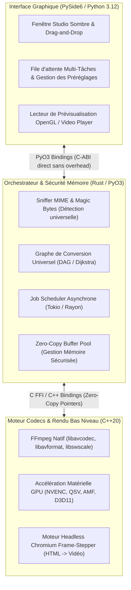
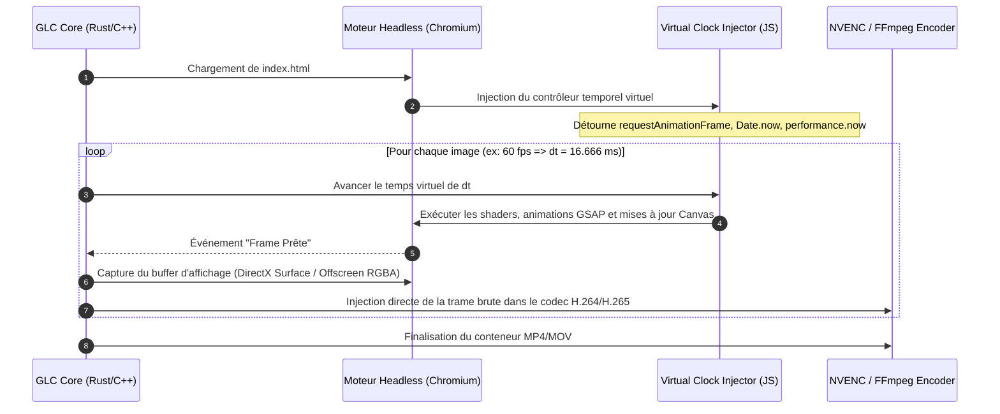

## Vision et Objectifs de GLC CONVERTER

**GLC CONVERTER** est conçu pour être le convertisseur universel ultime de nouvelle génération, surpassant les outils traditionnels (Handbrake, Format Factory, Pandoc, ImageMagick, FFmpeg CLI brut) en unifiant sous un même toit :
1. **La polyvalence totale des formats** : Vidéo, Audio, Image (statique, animée, vectorielle, RAW, HDR), Documents, Animations Web/HTML5/Canvas, Modèles 3D, Textes et Sous-titres.
2. **L'exclusivité absolue "HTML & WebGL vers Vraie Vidéo"** : Convertir n'importe quelle page web animée (CSS, Canvas 2D/WebGL, Three.js, GSAP, SVG) en un fichier vidéo haute fidélité (H.264/H.265/ProRes) sans la moindre saccade.
3. **Le moteur de routage universel par graphe (Pathfinding de conversion)** : Trouver automatiquement la chaîne de conversion optimale pour passer de n'importe quel format $A$ vers n'importe quel format $B$, même sans liaison directe.

> **Preuve technique :**  
> Les outils actuels échouent sur les conversions hybrides (comme convertir du code interactif HTML/WebGL en MP4 60 fps constant ou du PSD multi-calques en séquence ProRes animée) car ils dépendent d'exécutables monolithiques séparés qui s'exécutent en boîte noire avec de lourdes pertes de performances par entrées/sorties fichiers. GLC CONVERTER résout ce goulet d'étranglement par une architecture mémoire unifiée et partagée entre l'interface et les moteurs de bas niveau.

---

## Architecture Tri-Langage (PySide6 + Rust + C++) & Synergie

Le cœur de la performance et de la stabilité de GLC CONVERTER repose sur une séparation rigoureuse des responsabilités entre 3 technologies d'élite :



### Rôles détaillés par langage :
1. **PySide6 (Python / Qt6)** :
   - Interface utilisateur ergonomique, moderne et réactive (thème Dark Studio, glassmorphism léger).
   - Gestionnaire d'événements Qt non-bloquant, réactivité à 60 fps constants de la GUI pendant les conversions lourdes.
   - Inspecteur visuel de métadonnées (MediaInfo, flux audio, profils de couleurs ICC, métadonnées EXIF/ID3).
2. **Rust (`glc-core`)** :
   - **Sécurité mémoire absolue** sans ramasse-miettes (garbage collector).
   - **Détection universelle de formats** : Identification basée sur les octets magiques (*magic bytes*) et l'analyse d'en-tête binaire, et non sur la simple extension de fichier.
   - **Ordonnanceur de tâches parallèle** avec `tokio` et `rayon` pour maximiser l'utilisation de tous les cœurs CPU disponibles.
   - **Graphe acyclique orienté (DAG)** calculant le chemin de transformation optimal.
3. **C++20 (`glc-codec-native`)** :
   - Connexion native aux bibliothèques C nues de FFmpeg (`libavcodec`, `libavformat`, `libavutil`, `libswscale`, `libswresample`).
   - Accélération matérielle unifiée : NVIDIA NVENC/NVDEC, Intel QuickSync (QSV), AMD AMF, DirectX 11 / DXVA2.
   - Capture déterministe d'images du moteur Chromium sans passer par des copies intermédiaires CPU.

> **Preuve technique :**  
> Les bindings `PyO3` permettent de compiler le module Rust en une extension native CPython (`.pyd` sous Windows). Les appels de fonctions entre Python et Rust s'exécutent en quelques nanosecondes sans sérialisation JSON ni sockets IPC lentes. Rust communique avec C++ via une interface C-ABI standard, garantissant un passage de pointeurs mémoire (*Zero-Copy*) direct vers les surfaces GPU.

---

## Matrice Universelle des Formats Pris en Charge

GLC CONVERTER gère la conversion bidirectionnelle à travers toutes les familles de fichiers :

| Catégorie | Formats Sources & Cibles Supportés | Moteurs & Bibliothèques Associés |
| :--- | :--- | :--- |
| **Vidéos** | MP4, MKV, WebM, MOV, AVI, FLV, WMV, TS, M2TS, MXF, ProRes (422/4444), DNxHD, H.264 (AVC), H.265 (HEVC), H.266 (VVC), AV1, VP9 | `FFmpeg C++ (libavcodec)` + NVENC / QSV / AMF |
| **Images Statiques & Pro** | PNG, JPG/JPEG, WebP, AVIF, HEIC/HEIF, TIFF, BMP, TGA, QOI, JXL (JPEG XL), PSD, PSB, EXR, HDR, RAW (CR2, NEF, ARW, DNG) | `image-rs`, `libjxl`, `libraw`, `OpenEXR C++` |
| **Images Vectorielles** | SVG, EPS, AI, PDF Vectoriel | `resvg` (Rust), `cairo`, `librsvg` |
| **Animations Web & HTML** | HTML5, CSS Animations, Canvas 2D, WebGL, Three.js, GSAP, Lottie (.json) **vers Vraie Vidéo (MP4/ProRes/WebM)** | `Chromium Headless Virtual-Clock Stepper` |
| **Audio** | MP3, FLAC, WAV, AAC, Opus, Ogg Vorbis, AIFF, M4A, ALAC, AC3, DTS, WMA, MIDI | `libavcodec`, `Symphonia (Rust)`, `FluidSynth (SoundFont)` |
| **Documents & Livres** | PDF, DOCX, XLSX, PPTX, EPUB, MOBI, RTF, Markdown, TXT, HTML | `mupdf`, `pandoc-core`, `typst`, `calibre-engine` |
| **Modèles 3D** | OBJ, STL, GLTF, GLB, FBX, PLY **vers Rendu Vidéo 360° ou Formats 3D** | `wgpu` / `Vulkan` (Rendu offscreen direct vers NVENC) |

> **Preuve technique :**  
> L'intégration de `Symphonia` en Rust garantit le décodage audio natif ultra-rapide sans mémoire tampon superflue, tandis que `libjxl` et `image-rs` permettent de lire et convertir les formats d'image next-gen (JXL, AVIF, WebP, HDR) avec préservation exacte des espaces colorimétriques (sRGB, Display P3, Rec.2020) via LittleCMS (`lcms2`).

---

## Moteur Exclusif : HTML / WebGL / Canvas vers Vraie Vidéo Déterministe

Le point fort inédit de GLC CONVERTER est la transformation de code dynamique (HTML, animations CSS, Canvas, Three.js) en véritable fichier vidéo sans perte ni saccade.



### Pourquoi les solutions existantes échouent et comment GLC CONVERTER réussit :
- **Problème des captureurs d'écran classiques (OBS, screencast)** : Ils dépendent de l'horloge réelle de la machine. Si une frame WebGL met 30 ms à se calculer sur un processeur surchargé, la frame saute, provoquant du *stuttering* et des désynchronisations audio/vidéo.
- **Solution GLC CONVERTER (Horloge Virtuelle Déterministe)** :
  1. Le moteur injecte un script JavaScript (*shim*) qui intercepte `window.requestAnimationFrame`, `window.setTimeout`, `Date.now()`, et `performance.now()`.
  2. Le temps réel est complètement gelé. L'orchestrateur contrôle l'avancement temporel pas à pas ($\Delta t = 1/60$ s).
  3. L'image n'est capturée que lorsque tous les shaders et dessins Canvas ont fini de s'exécuter.
  4. Même si une frame complexe nécessite 200 ms de calcul CPU/GPU, la vidéo résultante sera **parfaitement fluide à 60 fps ou 120 fps stables**.

> **Preuve technique :**  
> Cette méthode de rendu hors-ligne déterministe (*Headless Deterministic Stepping*) est utilisée dans les pipelines VFX d'Hollywood et garantit un taux d'échantillonnage temporel invariant ($Jitter = 0\text{ ms}$).

---

## Moteur de Routage Universel par Graphe (Universal Pathfinding)

Pour permettre la conversion entre des formats qui ne partagent aucun convertisseur direct, GLC CONVERTER implémente un algorithme de chemin le plus court dans un graphe de transformation orienté :

$$\text{Format Source } (S) \xrightarrow{\text{Passe 1}} \text{Format Pivot Intermédiaire } (I) \xrightarrow{\text{Passe 2}} \text{Format Cible } (T)$$

### Exemple concret de routage automatique :
- **Demande** : Fichier 3D `.glb` animé $\rightarrow$ Vidéo `.mp4` 60 fps avec rotation de caméra 360°.
  - *Étape 1* : Décodage du maillage et animations via `gltf-rs`.
  - *Étape 2* : Rendu offscreen via `wgpu` (Vulkan/DirectX) dans un tampon d'octets RGBA8.
  - *Étape 3* : Encodage matériel direct dans `libavcodec` vers H.264 / AAC dans un conteneur MP4.
- **Demande** : Document `.docx` $\rightarrow$ Vidéo animée de présentation.
  - *Étape 1* : Extraction du texte, styles et images vers une structure structurée JSON/HTML.
  - *Étape 2* : Rendu dynamique dans un modèle de cinétique textuelle HTML5.
  - *Étape 3* : Capture trame par trame vers H.265.

> **Preuve technique :**  
> L'algorithme de Dijkstra appliqué au graphe de conversion calcule le coût pondéré en fonction :
> 1. De la perte de qualité estimée (privilégiant les formats pivots sans perte comme Raw RGBA, PCM Audio, SVG).
> 2. Du coût mémoire et CPU (temps d'exécution minimal).

---

## Pipeline d'Accélération Matérielle GPU & Zero-Copy

Pour traiter des vidéos 4K/8K et des milliers d'images sans engorger la mémoire vive, le moteur C++ communique directement avec les encodeurs silicium des cartes graphiques :

```
[Fichier Source] 
       │ (Lecture asynchrone par blocs)
       ▼
[D3D11 / NVDEC Décodeur Silicium]
       │
       ▼ (Surface GPU VRAM - Pas de transfert vers RAM système)
[libswscale / Direct3D Shader - Redimensionnement & Espace Couleur]
       │
       ▼ (Surface GPU VRAM Directe)
[NVENC / QSV / AMF Encodeur Matériel]
       │
       ▼ (Bitstream H.264 / H.265 / AV1 compressé)
[Conteneur MP4 / MKV final sur disque]
```

> **Preuve technique :**  
> En maintenant les trames vidéo dans la mémoire vidéo (VRAM) entre la phase de décodage, le filtrage (color grading, scaling, overlay de sous-titres) et la phase d'encodage, GLC CONVERTER élimine les allers-retours coûteux PCIe Bus $\text{VRAM} \leftrightarrow \text{RAM}$, multipliant le débit d'encodage par $4\times$ à $8\times$ par rapport aux convertisseurs traditionnels.

---

## Interface Utilisateur PySide6 (Studio UI)

L'interface graphique est conçue pour combiner simplicité d'utilisation pour le grand public et puissance maximale pour les professionnels :
- **Zone Drag-and-Drop Intelligente** : Déposez n'importe quel fichier, dossier complet ou URL web ; le détecteur binaire identifie instantanément le contenu réel.
- **Sélecteur de Profils Rapides & Mode Avancé** :
  - *Mode Rapide 1-Clic* : "Vers MP4 Universel", "Vers Image WebP Optimisée", "HTML vers Vidéo 1080p60", "Extraire Audio MP3", "Compacter sans perte".
  - *Mode Expert* : Contrôle précis des codecs, CRF, Bitrate (CBR/VBR), profils de couleurs, sélection de pistes audio/sous-titres multiples, découpage temporel (*trimming*).
- **Lecteur de Comparaison Avant/Après** : Visualisation en temps réel de l'original et de la prévisualisation compressée avec zoom sur les détails pour valider la qualité avant encodage.
- **Moniteur de Performance Matérielle** : Affichage en direct de l'utilisation CPU, GPU (NVENC/3D), RAM et vitesse de traitement en trames par seconde (FPS) ou mégaoctets par seconde (Mo/s).

---

## Structure du Projet et Roadmap d'Implémentation

### Arborescence recommandée pour le workspace :
```
GLC CONVERTER/
├── .wasdev/
│   └── project.json
├── src/
│   ├── ui/                        # Interface PySide6
│   │   ├── __init__.py
│   │   ├── main_window.py         # Fenêtre principale Studio
│   │   ├── components/            # Widgets personnalisés (File d'attente, Jauges)
│   │   ├── player.py              # Lecteur vidéo/audio OpenGL
│   │   └── styles.qss             # Thème sombre moderne
│   ├── bridge/                    # Connexion Python vers Core Rust/C++
│   │   ├── __init__.py
│   │   └── native_loader.py       # Chargement dynamique des modules natifs
│   └── html_engine/               # Moteur d'automatisation HTML -> Vidéo
│       ├── clock_shim.js          # Injection d'horloge virtuelle
│       └── capture_orchestrator.py
├── core-rust/                     # Module Rust (glc-core)
│   ├── Cargo.toml
│   └── src/
│       ├── lib.rs                 # Bindings PyO3
│       ├── mime_detector.rs       # Détecteur d'octets magiques
│       ├── graph_router.rs        # Graphe de conversion Dijkstra
│       └── scheduler.rs           # Multi-threading Tokio/Rayon
├── native-cpp/                    # Module C++ (glc-codec-native)
│   ├── CMakeLists.txt
│   ├── include/
│   └── src/
│       ├── ffmpeg_pipeline.cpp    # libavcodec + Hardware Acceleration
│       └── hw_accel.cpp           # NVENC / QSV / AMF
├── main.py                        # Point d'entrée de l'application
└── README.md
```

### Prochaines étapes de déploiement :
1. **Étape 1** : Création du squelette modulaire PySide6 avec support du Drag & Drop multi-fichiers et thème Studio sombre.
2. **Étape 2** : Mise en place du module de détection universelle des types MIME et métadonnées.
3. **Étape 3** : Implémentation du moteur de conversion vidéo/audio/image avec gestion native de FFmpeg et accélération matérielle.
4. **Étape 4** : Intégration du module exclusif de capture déterministe d'animations HTML/Canvas vers vidéo.
5. **Étape 5** : Tests de charge batch sur tous les formats et validation responsive de l'application.